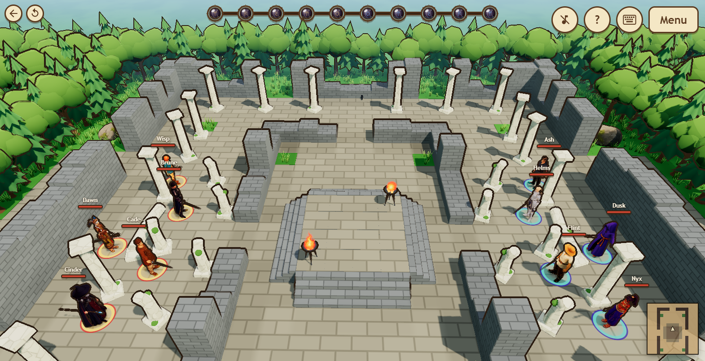
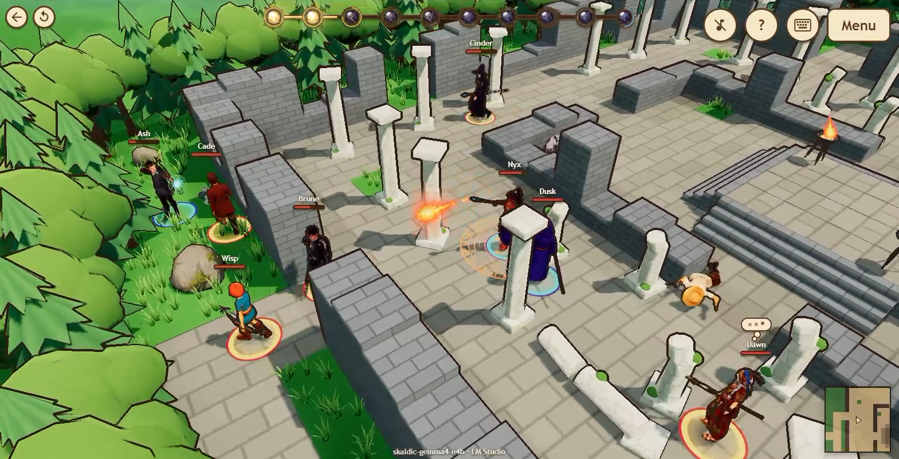
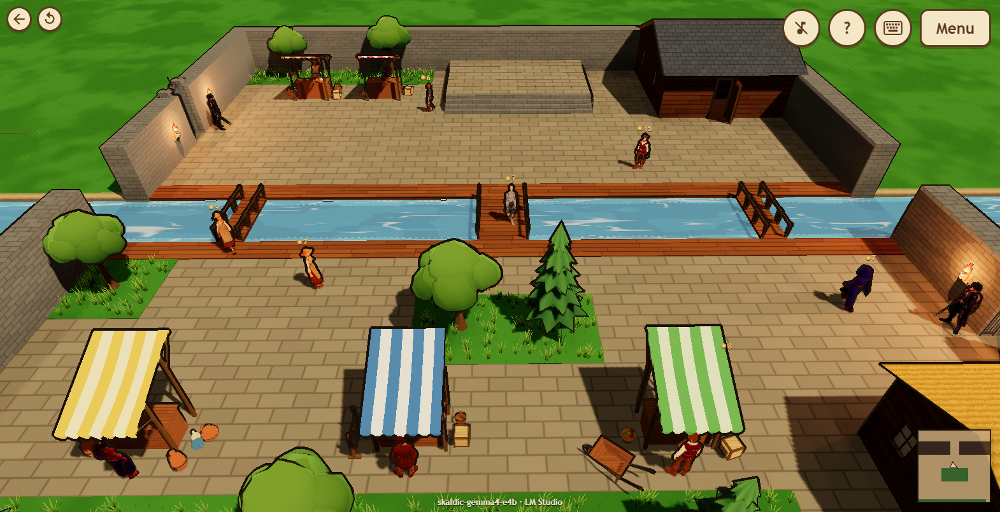
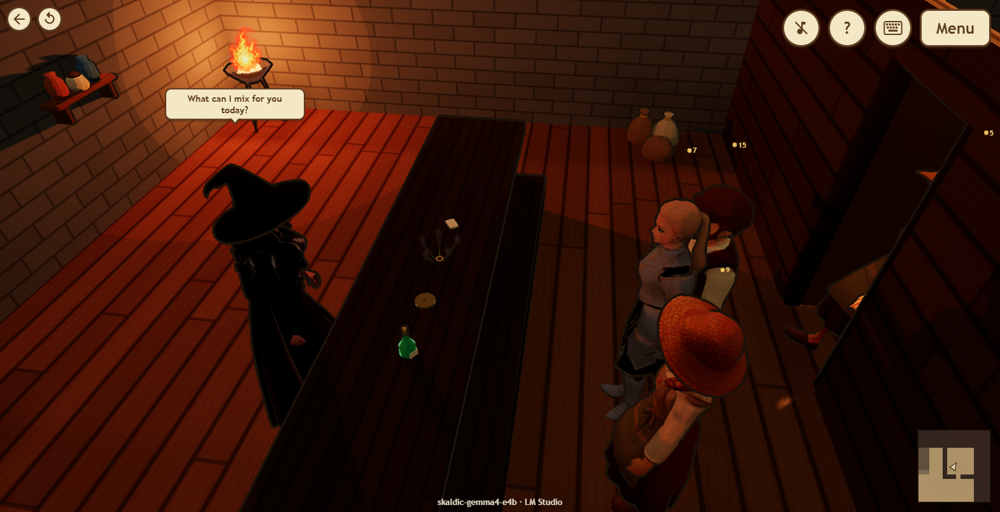
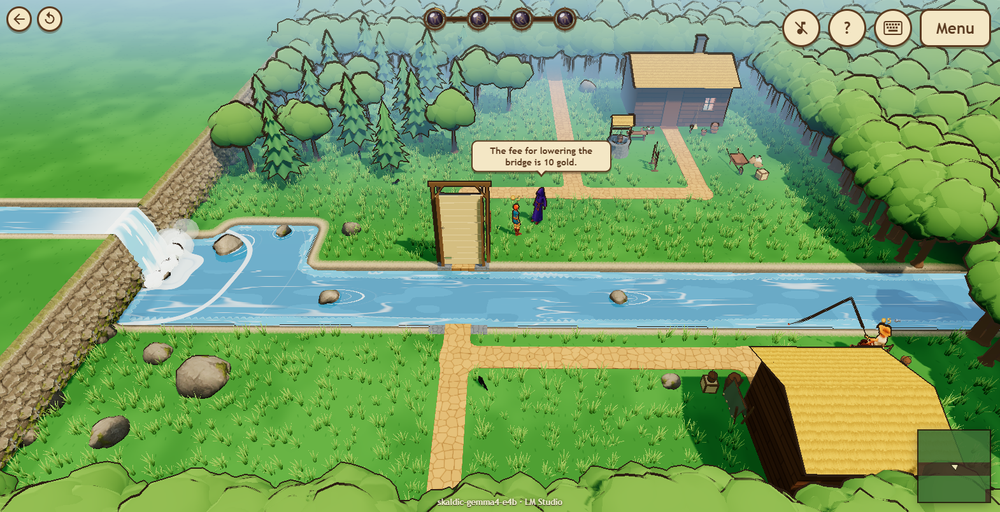
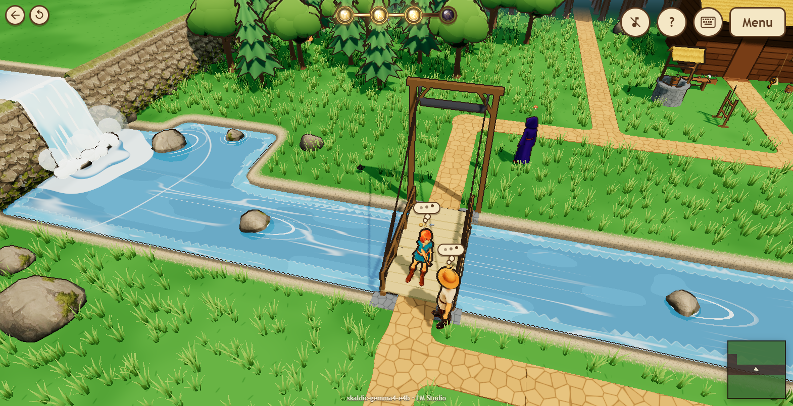
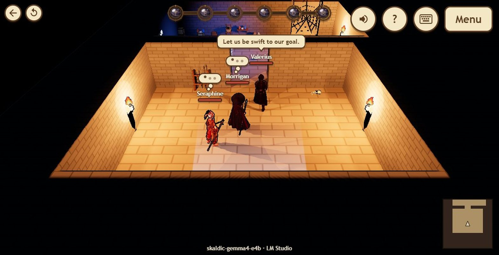
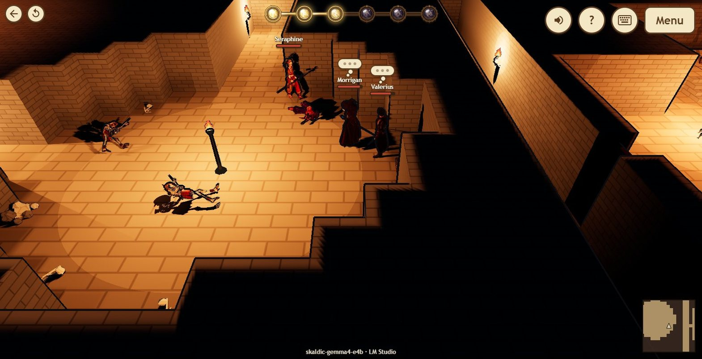

# ArcDirector

<!-- markdownlint-disable-next-line MD033 -->


**Give your game a cast that thinks for itself.** LLM-driven NPCs for browser games, running on the player's own GPU.

Most "AI NPCs" are chatbots wearing a costume: you type, they talk, nothing in the world changes. ArcDirector NPCs **act**. They look around, weigh what they know and what they want, write themselves a short plan, and then carry it out in your game: walking across the map, haggling over a price, handing over the key, burning the cobweb, flanking the archer. When a plan fails, they read why and try something else.

No behavior trees. No dialogue scripts. No cloud bill. Just a local model, a few callbacks into your world, and characters that surprise you.

## See it running: **[▶ Play the demo](https://arcdirector.com)**

No install, no account, no server. The NPCs think inside your browser, on your own GPU. Drop into a 5v5 battle, a busy marketplace or a dungeon crawl, and watch a cast of characters make their own plans.

### Four scenes to prove it

Every screenshot below is a live session: no scripted moves, nothing staged. Each NPC is steered by a local LLM through ArcDirector, inside the example game that ships in this repo.

| Scene | | |
| ----- | - | - |
| **5v5 Combat** |  |  |
| **Marketplace** |  |  |
| **River Glen** |  |  |
| **Dungeon Crawl** |  |  |

## What a plan looks like

Dawn captains a squad of five in the 5v5 scene. Nobody scripted an attack. In one think, Dawn wrote this and every fighter has followed it since:

```arc
issue(
    who=units.filter("Knight"),
    arc=loop(cleave(others.filter("enemy").minBy(u => u.hp)))
);
issue(
    who=units.filter("Blade"),
    arc=loop(slash(others.filter("enemy").minBy(u => u.hp)))
);
issue(
    who=units.filter("Archer"),
    arc=loop(shoot(others.filter("enemy").minBy(u => u.hp)))
);
issue(
    who=units.filter("Witch"),
    arc=loop(hex(others.filter("enemy").minBy(u => u.hp)))
)
```

That is an **Arc**: a tiny program of verbs, conditions and loops that the model writes and ArcDirector runs, frame by frame, against your game. The model is only called when someone has something to decide, so a single consumer GPU can keep a whole squad, a crowded market or a dungeon party busy.

## Why you'll like it

- **NPCs that change the world, not just the chat log.** Every verb ends in your code, and your game keeps the rules. Refuse an action with a reason and the NPC plans around it.
- **Runs locally.** LM Studio, Ollama or any OpenAI-compatible endpoint. Built for small models: forgiving parsing, self-repairing plans, cache-friendly prompts.
- **Fits any engine.** Pure TypeScript, zero rendering dependencies. Three.js, Babylon, an ECS or a tile grid all work.
- **Scales from one villager to an army.** One mind can command a whole squad or crowd, with formations and orders by tag.
- **Memory, goals and personality.** Characters remember what happened, know what you teach them about the world, and stay in character.
- **You can see every thought.** Each prompt, reply and decision is logged, so you always know why the blacksmith did what it did.

The full feature list, API and integration guide live in **[arc-director/README.md](arc-director/README.md)**.

## Try it in five minutes

You need [Node.js](https://nodejs.org/) 20+, [pnpm](https://pnpm.io/) and [LM Studio](https://lmstudio.ai/) with a chat model downloaded (Gemma 4 or Qwen 3 class models work well). No LM Studio? The game's first screen can download a model to run right in the browser instead (Chrome or Edge with WebGPU).

1. Start LM Studio's local server on its default port (`1234`).
2. Clone and run the example game:

	```sh
	git clone https://github.com/danielsig/ArcDirector.git
	cd ArcDirector
	pnpm install
	pnpm --filter @arc-director/game dev
	```

3. Open <http://localhost:5173/>, pick a scene, and watch.

Each scene opens with a short brief of what the cast is trying to do. By default you are an observer the NPCs never notice. Open **Menu → Testing** and set **Player** to **Participant** to step in yourself: talk to the NPCs, trade with them, or get in their way. **Camera** removes your character entirely, for clean screenshots.

| Scene | What happens |
| ----- | ------------ |
| **5v5 Combat** | Two captains command a squad each, adapt their orders as the fight turns, and heal the wounded. |
| **Marketplace** | Seven sellers mind their stalls and shops while a single mind runs the whole crowd of shoppers and guards. |
| **River Glen** | Three villagers each need something the others have, and the only bridge costs more than anyone can pay. |
| **Dungeon Crawl** | A knight, a healer and a witch fight their way through a crypt of riddles, locked gates and a skeleton king to reach the crown. |

## Use it in your own game

Add [`arc-director/`](arc-director/) to your workspace (or depend on it by path). Then follow **[arc-director/README.md](arc-director/README.md)**: connect a model, describe your world with a handful of callbacks, add characters, and call `tick` from your game loop. The example game in [`game/`](game/) is a complete integration to borrow from.

## What's in the repo

| Folder | What it is |
| ------ | ---------- |
| [`arc-director/`](arc-director/) | **The library.** Engine-agnostic characters, minds and collectives. Start here. |
| [`game/`](game/) | The example game used to test it (Vue + Three.js). |
| [`kindling/`](kindling/) | The small Unity-style runtime the example game is built on. See [kindling/README.md](kindling/README.md). |
| [`mcp/`](mcp/), [`control/`](control/) | Tools for driving a live game from an AI agent while developing. |

## Contributing

Issues, ideas and pull requests are very welcome.

## License

[MIT](LICENSE) © Daniel Sigurdsson
